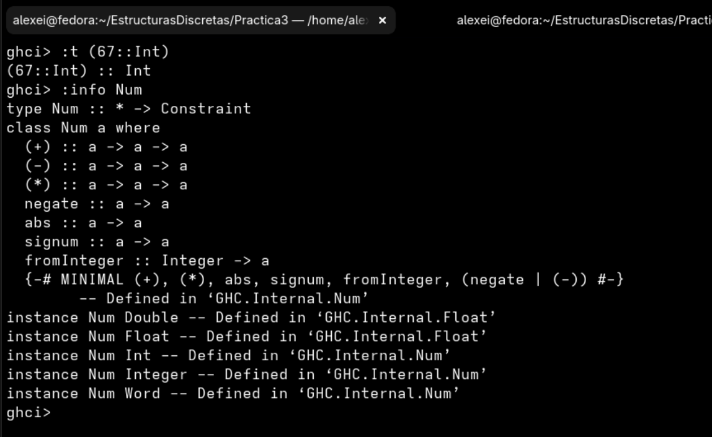

# Practica 3

## ¿Cuál es la diferencia entre Num e Int?

Int es un tipo de dato que representa numeros enteros, mientras que Num es una clase de tipos (typeclass) que agrupa tipos numericos como Int, Integer, Float y Double, los cuales permiten realizar operaciones aritmeticas basicas. En conclusion, Int es un tipo concreto y Num es una clase de tipos que define operaciones comunes para distintos tipos numericos.

En esta imagen se observa que Int es un tipo concreto y Num una clase de tipos: 

